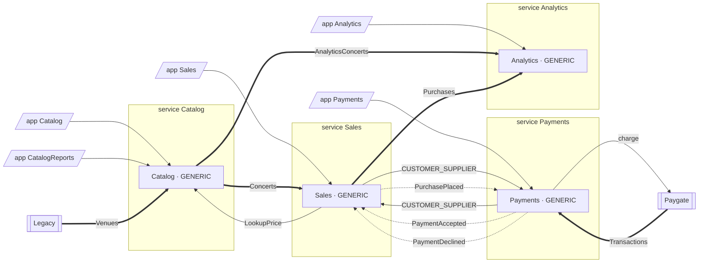
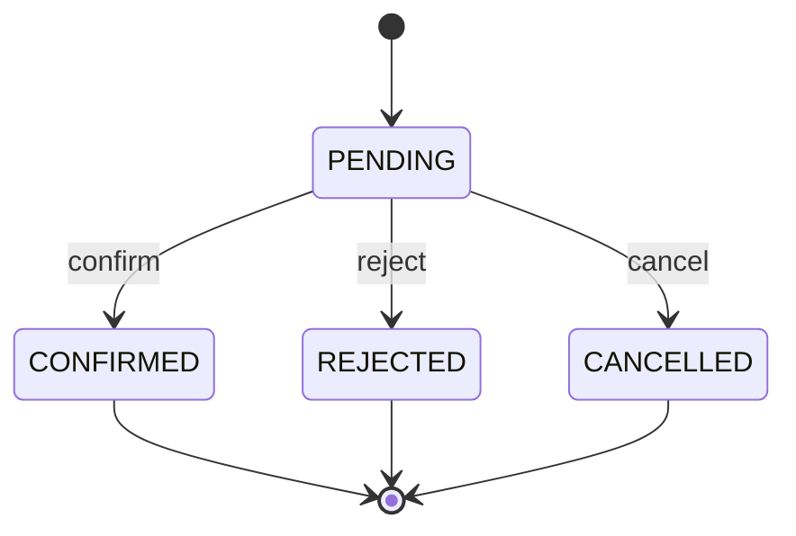

# HLA — Tickets

> Document generated from the modux model — do not edit by hand: it is a report of the specification.

## 1. Context and objective

A promoter sells tickets for its concerts. Far more people browse the catalog than buy; a purchase does not count until the payment confirms it, and if the payment fails the tickets go back on sale.

## 2. Decisions (ADR)

_No decisions recorded._

## 3. Structural view

_Arrows: solid — context-map relation (its type) or synchronous call (what it calls); dotted — event carried by a flow; thick — data a projection copies._

## 4. Responsibilities per container

| Container | Subdomain | Responsibility |
|---|---|---|
| Catalog | GENERIC | — |
| Sales | GENERIC | — |
| Payments | GENERIC | — |
| Analytics | GENERIC | — |
| Legacy _(external)_ | — | The old box-office system: its venues table is still the source of truth. |
| Paygate _(external)_ | — | The bank's payment gateway: charges a card and says whether it accepts the charge. |

### 4.1 Catalog

**Aggregates**

- **Concert**: artist, venue, date, capacity, price, status, zones, description

**Use cases** (besides each aggregate's CRUD)

| Use case | What it does |
|---|---|
| LookupPrice | Loads the concert by its id and returns its price, its status (ON_SALE or CLOSED) and its artist; if it does not exist, BusinessRuleException.notFound. |
| CloseSale | — |
| SalesDashboard | Reads the concerts. |
| Listings | Reads the concerts. |
| ToReview | Reads the concerts. |
| SearchConcerts | Reads the concerts. |
| ConcertDetails | Reads the concerts. |

**Read models**

- **VenueView** ← projection Venues: table `venues` of Legacy

**Queries**

- **Venues**: venues → Venue

### 4.2 Sales

**Aggregates**

- **Purchase**: concertId, customer, tickets, amount, card, status, reference, confirmedBy, reason

**Use cases** (besides each aggregate's CRUD)

| Use case | What it does |
|---|---|
| Buy | With the current price Catalog gives (lookupPrice): rejects if tickets is not between 1 and 6, if the concert is not ON_SALE or if it asks for more than are available («Only N tickets left»); available = capacity of ConcertView minus the tickets of that concert's purchases that are neither REJECTED nor CANCELLED. Otherwise creates the PENDING purchase with amount = price × tickets and returns PurchasePlaced. |
| ConfirmPurchase | — |
| RejectPurchase | — |
| CancelPurchase | — |
| ConfirmManually | — |

**Read models**

- **ConcertView** ← projection Concerts: state of Concert (Catalog)

### 4.3 Payments

**Aggregates**

- **Payment**: purchaseId, amount, status, reason

**Use cases** (besides each aggregate's CRUD)

| Use case | What it does |
|---|---|
| Charge | With the gateway's answer, records the Payment (purchaseId, amount, ACCEPTED if the gateway accepts it or DECLINED with the reason it gives) and publishes PaymentAccepted or PaymentDeclined. |

**Read models**

- **TransactionView** ← projection Transactions: `transactions` of Paygate

**Queries**

- **Transactions**: transactions → Transaction

### 4.4 Analytics

**Read models**

- **ConcertView** ← projection AnalyticsConcerts: state of Concert (Catalog)
- **PurchaseView** ← projection Purchases: state of Purchase (Sales)

**Queries**

- **Dashboard**: purchases → Purchase (grouped by `concertId`, only `status=CONFIRMED`)

## 5. Lifecycles

### Purchase

## 6. Cross-cutting concerns

- **Events**: 12 domain events. Flows carry 3 of them through Kafka, each with a DLQ: PurchasePlaced (Sales → Payments), PaymentAccepted (Payments → Sales), PaymentDeclined (Payments → Sales). Projections copy the state of 2 aggregates: Concert (Catalog → Sales, Analytics), Purchase (Sales → Analytics). The other 9 stay inside their context.
- **Outbox**: Sales and Payments store each event in the same transaction as the state change, and a relay sends it; Catalog publishes directly: a failure between saving and publishing loses the event.

## 7. Exposed contracts

### Application Analytics

- Sales dashboard

### Application Catalog

- Concerts
- Close the sale
- Venues
- Dashboard
- Listings
- To review
- Search

### Application CatalogReports

- Concerts

### Application Payments

- Payments
- Gateway transactions

### Application Sales

- Buy tickets
- Cancel a purchase
- Purchases

### API ConcertAPI

| Method | Path | Operation |
|---|---|---|
| POST | `/concert` | CreateConcert |
| PUT | `/concert/{id}` | UpdateConcert |
| DELETE | `/concert/{id}` | DeleteConcert |
| GET | `/concert` | ListConcert |

### API PaymentAPI

| Method | Path | Operation |
|---|---|---|
| POST | `/payment` | CreatePayment |
| PUT | `/payment/{id}` | UpdatePayment |
| DELETE | `/payment/{id}` | DeletePayment |
| GET | `/payment` | ListPayment |

### API PurchaseAPI

| Method | Path | Operation |
|---|---|---|
| POST | `/purchase` | CreatePurchase |
| PUT | `/purchase/{id}` | UpdatePurchase |
| DELETE | `/purchase/{id}` | DeletePurchase |
| GET | `/purchase` | ListPurchase |

## 8. Deployment

Images are pushed to `docker.io/miguelperezcolom`. Providers: email SMTP.

| Environment | Target | Where | Ingress |
|---|---|---|---|
| PROD | Kubernetes | namespace `tickets` · context `cloudfleet-hetzner` | `ec1.mateu.io` · TLS (letsencrypt) · DNS NETLIFY |

Every environment runs every service:

| Service | Port | Contexts |
|---|---|---|
| Catalog | 8091 | Catalog |
| Sales | 8092 | Sales |
| Payments | 8093 | Payments |
| Analytics | 8094 | Analytics |

## 9. Open points

_None — every recorded decision is resolved._
