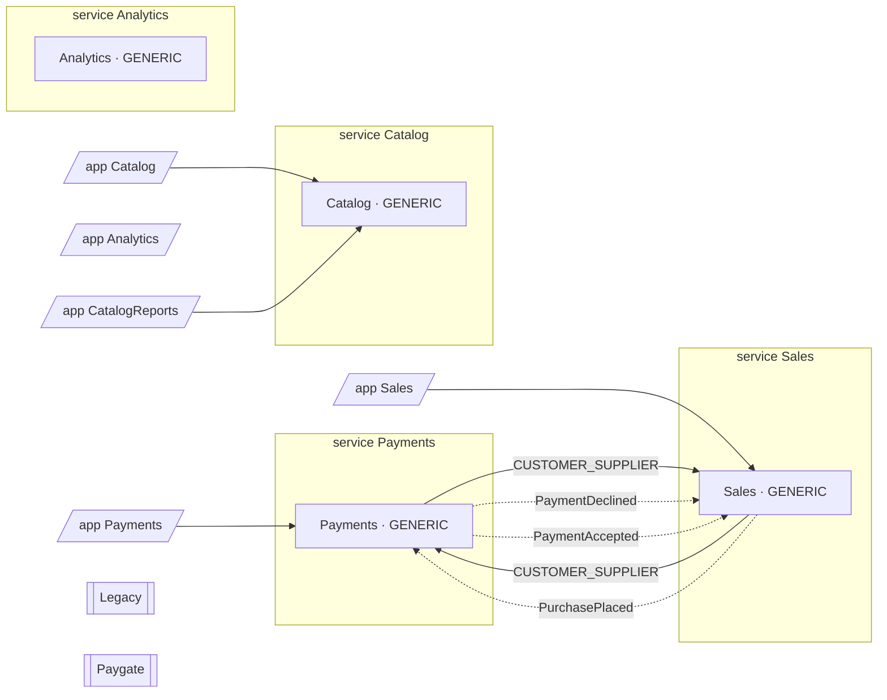
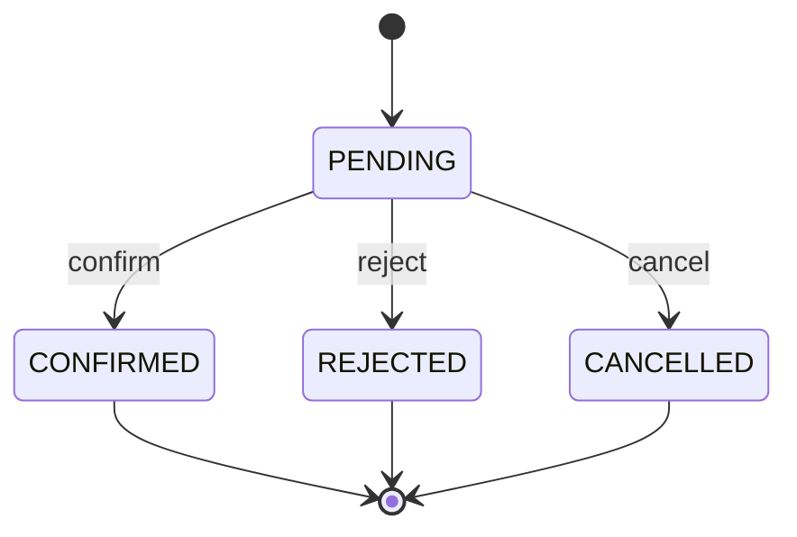

# HLA — Tickets

> Document generated from the modux model — do not edit by hand: it is a report of the specification.

## 1. Context and objective

A promoter sells tickets for its concerts. Far more people browse the catalog than buy; a purchase does not count until the payment confirms it, and if the payment fails the tickets go back on sale.

## 2. Decisions (ADR)

_No decisions recorded._

## 3. Structural view

## 4. Responsibilities per container

| Container | Subdomain | Responsibility |
|---|---|---|
| Analytics | GENERIC | — |
| Payments | GENERIC | — |
| Catalog | GENERIC | — |
| Sales | GENERIC | — |
| Legacy _(external)_ | — | The old box-office system: its venues table is still the source of truth. |
| Paygate _(external)_ | — | The bank's payment gateway: charges a card and says whether it accepts the charge. |

### Analytics

### Payments

**Aggregates**

- **Payment**: purchaseId, amount, status, reason

**Use cases** (besides each aggregate's CRUD)

| Use case | What it does |
|---|---|
| Charge | With the gateway's answer, records the Payment (purchaseId, amount, ACCEPTED if the gateway accepts it or DECLINED with the reason it gives) and publishes PaymentAccepted or PaymentDeclined. |

### Catalog

**Aggregates**

- **Concert**: artist, venue, date, capacity, price, status, zones, description

**Use cases** (besides each aggregate's CRUD)

| Use case | What it does |
|---|---|
| LookupPrice | Loads the concert by its id and returns its price, its status (ON_SALE or CLOSED) and its artist; if it does not exist, BusinessRuleException.notFound. |
| CloseSale | — |
| SalesDashboard | Reads the concerts. |
| Listings | Reads the concerts. |
| ToReview | Reads the concerts. |
| SearchConcerts | Reads the concerts. |
| ConcertDetails | Reads the concerts. |

### Sales

**Aggregates**

- **Purchase**: concertId, customer, tickets, amount, card, status, reference, confirmedBy, reason

**Use cases** (besides each aggregate's CRUD)

| Use case | What it does |
|---|---|
| Buy | With the current price Catalog gives (lookupPrice): rejects if tickets is not between 1 and 6, if the concert is not ON_SALE or if it asks for more than are available («Only N tickets left»); available = capacity of ConcertView minus the tickets of that concert's purchases that are neither REJECTED nor CANCELLED. Otherwise creates the PENDING purchase with amount = price × tickets and returns PurchasePlaced. |
| ConfirmPurchase | — |
| RejectPurchase | — |
| CancelPurchase | — |
| ConfirmManually | — |

## 6. Lifecycles

### Purchase

## 7. Cross-cutting concerns

- **Events**: 12 domain events, 0 published as integration events, 0 with a DLQ.
- **Outbox**: Payments, Sales stores each event in the same transaction as the state change, and a relay sends it; Analytics, Catalog publishes directly: a failure between saving and publishing loses the event.

## 8. Exposed contracts

### Application Catalog

- Concerts
- Close the sale
- Venues
- Dashboard
- Listings
- To review
- Search

### Application Sales

- Buy tickets
- Cancel a purchase
- Purchases

### Application Analytics

- Sales dashboard

### Application CatalogReports

- Concerts

### Application Payments

- Payments
- Gateway transactions

### API PurchaseAPI

| Method | Path | Operation |
|---|---|---|
| POST | `/purchase` | CreatePurchase |
| PUT | `/purchase/{id}` | UpdatePurchase |
| DELETE | `/purchase/{id}` | DeletePurchase |
| GET | `/purchase` | ListPurchase |

### API ConcertAPI

| Method | Path | Operation |
|---|---|---|
| POST | `/concert` | CreateConcert |
| PUT | `/concert/{id}` | UpdateConcert |
| DELETE | `/concert/{id}` | DeleteConcert |
| GET | `/concert` | ListConcert |

### API PaymentAPI

| Method | Path | Operation |
|---|---|---|
| POST | `/payment` | CreatePayment |
| PUT | `/payment/{id}` | UpdatePayment |
| DELETE | `/payment/{id}` | DeletePayment |
| GET | `/payment` | ListPayment |

## 9. Open points

_None — every recorded decision is resolved._
